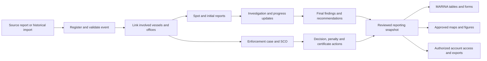

# SAFERSEAS: MARINA workflow and reporting audit

**Developer handoff | 6 November 2026 | Evidence: supplied MARINA files and local source code**

**Confirmed scope update, 6 November 2026:** There will be no public interface. Reporting requires an account issued by MARINA. The target is an authenticated system for authorized reporters and MARINA staff, with role/office permissions. Public self-registration, anonymous submission, unauthenticated tracking and public incident browsing/maps are out of scope and must be disabled at the API as well as the UI. References to “public” below in the existing-capability and defect inventories describe the inspected legacy implementation, not a retained product requirement. Exact reporter/staff roles and scopes remain proposed for MARINA to assign.

## 1. Assessment

SAFERSEAS has a useful foundation: incident intake, attachments, administrative review, vessel records, reference-data maintenance, maps, analytics, account permissions and notifications. It does **not yet reproduce MARINA's investigation, enforcement and recurring reporting workflow**. A generic incident dashboard cannot replace the supplied master lists and forms without changes to the data model, counting rules, permissions and document outputs.

The highest priorities are:

1. Require MARINA-issued accounts and correct review authorization, data disclosure and misleading statistics before loading sensitive MARINA material.
2. Import the historical files through a reviewed staging process that preserves original rows, merged groups, source evidence and unknown values.
3. Separate an accident/event from its involved vessels, investigation reports and enforcement cases.
4. Add distinct homeport, CPC office, AOR and issuing-office fields, and structured SCO, decision, penalty and certificate actions.
5. Generate MARINA's actual master-list, monthly-summary, casualty, SCO and MAIC outputs from a common, reproducible reporting selection.
6. Validate with MARINA the remaining business decisions listed in section 13. The files establish many requirements, but they do not establish every approval rule, deadline calculation or desired map layout.

**Scope and limits.** This is a source-code and source-file audit, not a certification of the deployed system. All six files in `MARINA data/` were inspected; all 12 pages of the scanned MAIC form were visually reviewed. Both PDFs were text-extracted, with visual review of the report tables and master-list layout. All workbook sheets were inventoried and their underlying values/formulas inspected. The application was not connected to a production database, and live workflows, delivery of emails, deployed storage permissions and browser rendering were not tested in this audit. “Present” below means implemented in inspected source, not proven operational. No application source was changed.

Code baselines, all with clean git status when recorded:

| Repository | Commit |
| --- | --- |
| `saferseas-backend` | `c7786c84ea896de4d8208a155b9b29ba1af0a4a1` |
| `saferseas-frontend-admin` | `35219243c35bf40e670ad29b604a25f75803e8cd` |
| `saferseas-frontend-public` | `d41c5bfd0662a68cbaa5d50bf34ebaf73e1d44b2` |

The code references in this document use repository-relative paths and one-based line numbers at these commits. Requirements marked **Observed** come from the supplied files. **Proposed** means a recommended implementation or output, subject to MARINA validation. **Confirm** identifies a decision the files cannot settle. No external legal or regulatory requirements are asserted here.

## 2. What MARINA supplied

| ID | Source | Inspected structure and significance |
| --- | --- | --- |
| S1 | `MARINA data/2018-2022 Matrix Marine Accidents-Incidents.xlsx` | Five annual sheets: `2018`, `2019`, `2020`, ` 2021` (leading space), `2022`. Earlier sheets combine vessel name/GT and date/time; 2022 separates more fields. Contains multi-vessel continuations, narrative causes, consequences, recommendations, actions and remarks. |
| S2 | `MARINA data/2023 MASTER LIST-Matrix of Marine Accident.Incident.xlsx` | `MASTER LIST`, `SUM TYPE OF ACCIDENTS`, `SCO SUM`. Master-list headings A2:Y2 include jurisdiction, IMO seriousness, size, classification society, recommendations, status, SCO, decision, penalty and remarks. |
| S3 | `MARINA data/2024 MASTER LIST-Marine Accidents_Incidents (2).xlsx` | `INVENTORY LIST`, `ACCIINCI SUM`, `CASUALTY SUM`, `SCO SUM`, `DROPDOWN`, empty `UNREGNOT HOMEPORTED`, `Legend`. Master headings A2:AA2 add rig type and CPC. Summary sheets show the recurring reporting package. |
| S4 | `MARINA data/2025 MASTER LIST of Marine Incidents_Accidents1.xlsx` | `MASTER LIST`, `LIST SUMMARY`, `SCO`, `CASUALTIES`, `TOTAL SUMMARY`, `MAIC FORMS`, `DROPDOWN`. Master A2:AL2 spans 38 physical columns, including hidden computed office J and hidden evidence-link column X. Separates SCO within/beyond 72H, case number, issuing office, issue date, violations, decision/order and penalty. |
| S5 | `MARINA data/2026 MASTER LIST of Marine Incidents-Accidents .pdf` | 13-page PDF: cross-year tables p1; monthly matrices p2; master-list content pp3-4; SCO summary p7; casualties p8; further selected master-list rows p9; an overseas entry p12; Filipino crew/passenger incidents p13. Some pages contain headers without records. This is a reporting snapshot, not a clean data exchange file. |
| S6 | `MARINA data/MAIC FORM SAFETY INVESTIGATION.pdf` | 12 scanned pages, no usable text layer or interactive form fields. Spot report p1; MAIC Form 1B initial report pp2-5; Form 2 progress report pp6-7; Form 3B final report pp8-12. No Form 1A template is supplied, although S4 tracks its receipt. |

**Observed reporting pattern:** MARINA maintains a detailed vessel/event register, obtains investigation reports and supporting evidence, records action/enforcement outcomes, and prepares repeated monthly and annual summaries. Homeport reporting, AOR reporting and enforcement-office reporting are distinct views of the same operational material.

### 2.1 Record counts are not interchangeable

These are **candidate vessel-name rows**, counted from each main register after row 2 and excluding the repeated header at S4 `MASTER LIST!18:18`. They are useful import control counts, not certified accident totals:

| Year | Candidate vessel-name rows |
| --- | ---: |
| 2018 | 164 |
| 2019 | 148 |
| 2020 | 102 |
| 2021 | 256 |
| 2022 | 133 |
| 2023 | 209 |
| 2024 | 281 |
| 2025 | 237 |

For example, S4 has 237 candidate vessel rows but only 205 nonblank type anchors and 205 nonblank seriousness anchors, with shared event cells merged across vessel rows. S4 cached `LIST SUMMARY!O14` is 205 and `O49` is 237. The difference is not automatically missing data: one event can involve several vessels. S3 instead has seriousness populated per vessel more often, so copying one year's counting assumptions to another is unsafe.

S5 p1 reports 2025 totals of **184 by accident type, 211 by vessel type and 205 by seriousness**, whereas S4 has cached totals of 205 by accident type and 237 by vessel type. S5 p2 also has different totals across dimensions. Some differences may be intentional populations, some may be incomplete snapshots or errors. They require reconciliation; do not force every total to agree by deleting records.

Additional source controls, as supplied and without recalculation:

| Comparison | Workbook control | S5 PDF control | Interpretation |
| --- | --- | --- | --- |
| 2023 accident-type total | S2 `SUM TYPE OF ACCIDENTS!O15`: 188 cached | p1: 190 | Conflicting historical snapshots. |
| 2024 vessel-type total | S3 `ACCIINCI SUM!O54`: 281 cached | p1: 277 | Detail/workbook population differs from later summary. |
| 2024 seriousness | 281 populated raw classifications; S3 `ACCIINCI SUM!O39`: 253 cached | p1: 253 | Raw vessel-level classifications cannot simply be summed as event classifications. |
| 2026 casualties within the same PDF | No 2026 XLSX supplied | p1: 85 deaths,24 missing,1 injured =110; p8: 163 fatalities,33 missing,1 injured =197 | Competing snapshots; do not add or silently choose one. |
| 2026 AOR | No 2026 XLSX supplied | p1 total115; p2 total183 | p1 visibly lists only some offices; total/coverage must be confirmed. |

S5 p1's AOR rows are a visible subset: for 2025 the six displayed regions sum to 112 while the printed total is 184. Do not treat that page as a complete AOR distribution. Cache values are historical stored results, not calculations rerun by this audit.

## 3. Workflow the product needs to support

The following combines observed stages with a proposed screen/data structure. It is a development recommendation, not a claim that MARINA approved this exact state machine.

| Stage | Observed evidence | Existing prototype | Required change |
| --- | --- | --- | --- |
| Receive a report | S6 p1 allows Facebook post, PCG report, marine protest and other source copies | Legacy public/anonymous intake, reporting-channel lookup, file attachments | Replace open intake with sign-in using a MARINA-issued account. Add a short spot-report path; retain source identity/copy, received date, reporting office and authenticated submitter separately. External information sources can still be recorded by authorized reporters. |
| Register and validate | S1-S5 preserve annual item numbers, dates, vessel characteristics and place descriptions | Generated incident ID, date/time and a single vessel snapshot. Coordinates are nullable in backend, but public intake requires coordinates, region and province. | Preserve original annual item/reference; distinguish event, vessel involvement and source row; record date/time precision and raw place text. Allow unknown/approximate and overseas locations without invented coordinates or Philippine locality. |
| Determine offices | S3/S4 homeport, CPC and AOR; S4/S5 SCO office rules | Civil region/province, ports and generic reporting authorities | Add MARINA office reference data and distinct office relationships. Geographic province or reporting authority cannot substitute for these roles. |
| Initial investigation | S6 Form 1B: seriousness, consequences, ship particulars, narrative, initial actions, recommendations, submitter/director | Most narrative and some vessel fields exist | Add typed, versioned initial report and missing particulars/consequences. Separate the preparer from the director who notes it. |
| Progress reporting | S6 Form 2: updates 72 hours after occurrence, recovery/rescue, certificate/SRB actions and SCO/legal proceedings | Status comments and editable incident narrative | Add repeatable dated progress reports and structured actions, conditions, effective dates and evidence. A review status change is not an investigation update. |
| Final investigation | S6 Form 3B: factual data, findings, causal checklists, analysis, conclusion, lessons and safety recommendations | Findings/recommendations text, cause and crew-factor lookups | Add form-specific sections, structured causal taxonomy, final-report versions and signoff metadata. |
| Enforcement | S4 Z:AL and S5 p7: SCO, cases, violations, decisions, penalties and outcomes | No structured enforcement-case entities found | Add one-to-many enforcement cases/actions linked to event and relevant vessel/operator. Preserve within/beyond72H source labels and underlying dates. |
| Compile reports | S2-S5 repeated matrices, casualty and SCO tables, form-receipt counts | Interactive analytics, configuration/vessel CSV, local table CSV, several placeholder actions | Build the output catalogue in section 8 using one report service and stable snapshot. |
| Authorize access and release | Source files include sensitive evidence and personal details; account-only access is confirmed by the user | Legacy verification plus `isSecret` controls public eligibility in some endpoints | Disable public/anonymous routes and enforce account, role, office and record permissions across tracking, detail, maps, downloads and attachments. Verification must not grant all account holders access automatically. |

**Keep three states separate:** data-review state, investigation-report state and enforcement-case state. `verified` does not mean investigation completed, case closed, penalty settled or unrestricted access within the system.

## 4. Existing capability and fit

Status key: **Present** = implemented in source; **Partial** = useful foundation with material gaps; **Placeholder** = static/local/no effective action; **Missing** = no implementation found in inspected paths; **Unverified** = needs runtime validation.

| Capability | Status | Evidence and assessment |
| --- | --- | --- |
| Backend incident register | Partial | `saferseas-backend/incidents/models.py:159` defines Incident, copied vessel particulars, coordinates, casualties, text narratives, lookups and reviewer fields. It lacks MARINA enforcement and document lifecycle entities. |
| Public/owner incident intake | Partial | `incidents/view/incidents.py:216`; public multi-step forms. Supports attachments and resubmission, but requires authorization fixes and a shorter initial intake. |
| Administrative incident review | Partial | `incidents/view/incidents.py:74`, `:84`; admin list/detail and approval permissions exist. Current generic updates do not enforce a complete MARINA transition/signoff model. |
| Vessel registry | Partial | `incidents/models.py:106`; links to incidents and public owners. Registry GT is integer while Incident GT is decimal; needs historical vessel snapshots and multi-vessel relationships. |
| Reference configuration | Present/Partial | CRUD APIs in `incidents/view/admin_views.py`; CSV in `view/export.py`. Retain this foundation, extend with MARINA offices, rig/hull/size codes, report types and enforcement outcomes. |
| Shipping-company administration | Placeholder in inspected admin screen | Local demo records/mutations are not a maintained operator register. Existing backend Ship associates a company with a public account, not a full historical company registry. |
| Dashboards and analytics | Partial | `incidents/view/analytics.py`, `dashboard*.py` implement aggregates, trends and quality views. Misclassification, sample fallbacks and inconsistent filters must be corrected before official use. |
| GIS and hotspots | Partial | `incidents/view/incidents_map.py` has GeoJSON and port fallback; the endpoint called heatmap aggregates by date. Missing precision/coverage controls and capped results can mislead users. |
| Risk assessment | Partial/prototype methodology | Stored scores/inputs and admin UI exist. Backend accepts caller scores; regional/seasonal methods are heuristics. Supplied MARINA files do not establish these methods as approved risk models. |
| Policy insights | Placeholder | Inspected PolicyInsights screen contains fixed claims and export/briefing buttons without reporting implementation. Exclude its claims from official outputs until replaced. |
| Incident/report exports | Partial/Missing | Some tables create local CSV and reference/vessel CSV endpoints exist. No backend MARINA incident, summary XLSX, MAIC PDF/DOCX or reproducible report-bundle generation found. Analytics CSV action is a notification placeholder. |
| Existing incident PDF briefing | Present, runtime-unverified | Public `src/services/printService.js:44` implements a pdfmake briefing with optional map capture and `.download()` at `:634`. Reuse useful rendering work; this is a SAFERSEAS briefing, not reproduction of the supplied MAIC forms. Public tracking-page browser print is a separate capability. |
| Historical migration | Missing | No reviewed MARINA workbook/PDF parser, source-row staging, mapping approval or idempotent import workflow found. Seed commands and uploading a spreadsheet as an attachment do not implement migration. |
| Report receipt/compliance tracking | Missing | S4 `MAIC FORMS` needs report-type receipts per office; generic attachment labels/status logs cannot reproduce it reliably. |
| Audit trail and notifications | Partial | Status logs and model-history registration exist; notification/email infrastructure exists. They do not provide original-source lineage, report revision approvals or guaranteed MARINA deadline escalation. |
| Access control | Partial | Distinct admin/public accounts and application permissions exist. Several map/analytics/export paths use weaker checks than incident lists. See section 5. |
| Operational validation | Unverified | Source inspection does not establish deployed services, attachment ACLs, backup/recovery, delivery reliability or performance. Add end-to-end acceptance tests after the model/API changes. |

## 5. Defects to correct before official use

These findings are based on inspected control flow, not live penetration testing. P0 blocks loading or exposing sensitive MARINA material; P1 blocks reliable workflow/reporting; P2 is a subsequent product correction.

| ID | Priority | Finding and evidence | Required result / acceptance check |
| --- | --- | --- | --- |
| D01 | P0 | Public `IncidentCreateView` accepts all `STATUS_CHOICES`, including `verified`, and updates an existing unrestricted ID/reference without an ownership check. It also assigns owner/secrecy from the current caller. `saferseas-backend/incidents/view/incidents.py:219`, `:295`, `:302`, `:308`, `:334`, `:344`. | Require an active MARINA-issued account; reject anonymous create/update directly at the API. Separate create/update and authorize each object. Reporter accounts cannot verify, alter another record, change ownership or write reviewer fields without the assigned permission. Authentication alone does not authorize these actions. |
| D02 | P0 | Tracking permits detailed nonsecret records without a verified-status check; verified serializers/maps include contact/evidence fields. Admin GeoJSON/analytics omit incident-list permission checks; configuration/vessel CSV export checks authentication without each resource's relevant permission. `incidents/view/incidents.py:417`, `:466`, `:546`, `:768`; `incidents/serializers.py:188`; `view/incidents_map.py:138`; `view/analytics.py:17`; `view/export.py:10`. | Retire public tracking/browsing endpoints or protect them with account, role, office and record permissions. Apply matching scopes to all list/detail/map/aggregate/export and evidence paths. Anonymous users must receive no incident data; reporter and staff accounts receive only their authorized scope. |
| D03 | P1 | Empty/missing dashboard data produces illustrative coverage percentages, environmental values and PCG/MARINA authority counts. `view/dashboard_coverage.py:30`; `dashboard_environmental.py:24`, `:51`; `dashboard_summary.py:109`, `:118`, `:142`. | Missing observations return unavailable/empty with coverage counts. An empty database must not show plausible statistics. Never use prototype fallback figures in an official report. |
| D04 | P1 | Analytics “Serious” substring includes “Less Serious”; its “Less Serious” branch excludes it. Dashboard helper recognizes Critical/High/Medium/Low but none of MARINA's three seriousness labels. `view/analytics.py:53`, `:178`; `view/helpers.py:24`; related verified stats at `view/incidents.py:747`. | Explicit mutually exclusive seriousness codes. A fixture with one of each seriousness and one unknown reconciles in every screen, table and export. Distinguish seriousness from impact and risk. |
| D05 | P1 | `method_of_reporting` is a single FK, but create converts it to a list and the shared filter uses nonexistent `reporting_methods__id`. `incidents/models.py:236`; `view/incidents.py:237`, `:288`; `incidents/services.py:145`. | Match payload, serializer and filter cardinality. Valid reporting-channel entry/filter works across create, list, map and totals. |
| D06 | P1 | Filters differ by endpoint: IDs/codes in lists, names/literals in analytics, separate dashboard defaults. Analytics ignores the displayed weather selection; verified map omits list search. `incidents/services.py:77`; `view/analytics.py:30`; `view/incidents.py:841`. | One validated selection contract. Unsupported filters fail visibly; no silent ignore. The same selection yields the same population on screen and in downloads. |
| D07 | P1 | GeoJSON caps at 5,000; verified map at 1,000 without completeness metadata. Coordinate fallback independently chooses latitude/longitude by truthiness and may mix incident and port coordinates. `view/incidents_map.py:70`, `:102`, `:149`, `:178`; `view/incidents.py:893`. | Atomic validated coordinate pairs, explicit approximate/port provenance, and full count/pagination or server aggregation. Show mapped, approximate, unlocated and truncated counts. |
| D08 | P1 | Risk scores/bands/flags are caller-writable, and create/edit/delete do not enforce the corresponding seeded action permissions. Regional/seasonal scores use relative frequency, fixed/proxy assumptions and incomplete scopes. `incidents/serializers.py:320`; `view/risk_assessment.py:12`; `locations/utils.py:36`; `locations/views.py:74`. | Recalculate approved scores on server with methodology version/input provenance and action permissions. Until validated, label as prototype analysis and exclude from official MARINA statistics. |
| D09 | P1 | Integer defaults make unknown crew/passenger/fatality/injury values zero. Save recomputes total onboard as crew+passengers, losing an independently known total. Vessel registry GT is integer. `incidents/models.py:113`, `:226`, `:286`. | Nullable counts with explicit knowledge status; preserve source totals and decimal GT. Import tests distinguish unknown, not applicable and observed zero. |
| D10 | P1 | Review fields are generically writable and not reliably stamped by a backend approval transition. `incidents/serializers.py:188`, `:255`; `view/incidents.py:84`. | Backend stamps approver/time, validates transitions and captures reason/version. Test verified records always have attributable approval metadata. |
| D11 | P2 | Historical vessel age uses current year; harm/severity rankings reuse a top-ten set selected by record count; “verified cause” and completeness labels are proxies. `view/analytics.py:95`, `:140`, `:203`, `:263`. | Define age basis, rank by selected metric, and publish metric definitions/coverage. Do not describe a nonempty cause field as an approved investigative finding. |
| D12 | P1 | Admin GIS page calls owner-scoped `/heatmap/` and `/geojson/`; another hotspot screen calls `/geojson/admin/`. Owner endpoints use `PublicJWTAuthentication`. | Wire admin map to a permission-scoped administrative endpoint; test that selection/coverage agrees with the admin incident register. |
| D13 | P1 | Several visible report/export actions are static, notification-only or local-table CSV. | Each enabled output action must generate the documented artifact and include the entire authorized selection. Hide unfinished actions or label them explicitly while development continues. |
| D14 | P1 | Admin Edit navigates to an undefined edit route; legacy anonymous tracking's resubmit link targets a protected dashboard route. Admin owner/operator detail mapping uses different keys from the backend tracking response. | Make staff editing and signed-in reporter correction/resubmission functional; retire anonymous tracking/resubmission. Standardize the detail response contract and test account/record permissions end to end. |
| D15 | P1 | Public resubmission keeps only the first primary cause; edited singular authority can be overridden by a stale plural array; existing uploads are reset in the local form. `saferseas-frontend-public/src/pages/Dashboard/Incidents/Create.vue:527`, `:533`, `:538`, `:1035`. | Round-trip every cause/authority and verify server retention of existing attachments. Do not silently discard prior report detail when asking for corrections. |
| D16 | P1 | Compliance graphic initializes demo bars, retains them on API failure and floors actual percentages at 20%; incident counts are labelled as review-target compliance. `saferseas-frontend-admin/src/pages/Dashboard/HomePage/components/ComplianceChart.vue:7`, `:60`, `:72`, `:81`. | Use a defined compliance numerator/denominator and true zero/unavailable states. No demo values on API failure. |
| D17 | P2 | Risk calculator blocks saving score 0 unless a hard stop is true. `saferseas-frontend-admin/src/pages/Dashboard/Monitoring/RiskAssessment/CreatePage.vue:514`. | Support an approved all-clear/zero-score and insufficient-data result. Preserve the distinction between unscored, clear and manual-review assessments. |
| D18 | P1 | Admin safety score uses global incident counts but filters vessels using a public-account FK equal to the admin's numeric user ID; unrelated account IDs can overlap. Score is a raw-count weighted deduction, not an exposure rate. `saferseas-backend/incidents/view/dashboard_summary.py:29`, `:40`, `:52`; `dashboard_stats.py:18`, `:25`. | Separate staff/global and public-owner populations. Remove misleading safety claims until numerator, denominator and approved method agree. Test identical numeric admin/public IDs belong to different principals. |

For D12-D17 and other frontend evidence paths, see section 14. The frontend and backend issues need joint fixes; changing labels alone will not repair the underlying reporting populations.

## 6. Data changes and field mapping

### 6.1 Recommended entities

Extend the existing Django model/API foundation. The following names are proposed; the important requirement is to preserve the relationships and meaning.

| Entity | Responsibility |
| --- | --- |
| Event | One accident/incident occurrence: stable ID, original references, occurrence date/time and precision, initial/subsequent event types, seriousness, place text and location quality, source and review state. |
| EventVessel | Many involved vessels per event, each with incident-time particulars, registration state, service type, owner/operator snapshot, homeport/CPC, consequences and allocated counts. Link to reusable Vessel identity without rewriting history when its name/company changes. |
| MarinaOffice | Stable office code, source aliases and effective dates. Distinct relationships for AOR, homeport/registry office, CPC office, investigating office and actual issuing office. Allow international/unknown explicitly. |
| InvestigationReport | Spot/1A/1B/2/3B type, report/reference number, revision, report date, received date, author/name/designation, submitting office, noted-by director/date, structured content, attachments and workflow. Only implement 1A output after obtaining its template. |
| InvestigationAction | Recommendation/action, responsible office/person, requested/due/completed dates, outcome, evidence and follow-up history. Preserve source action narrative as well. |
| EnforcementCase | Case number, responsible/issuing office, linked event/vessel/party, alleged violations, case status, SCO records, decisions/orders and monetary penalty. One event may have multiple cases and parties. |
| EnforcementAction | SCO issuance/service, decision/order, penalty assessment/status, suspension/lifting of safety certificates or SRB; typed dates, conditions, documents and audit actor. Do not reduce repeated actions to one mutable text field. |
| ConsequenceObservation | Fatal/missing/injured/rescued counts by person category and as-of/report version; ship fit/unfit/total loss, environmental consequences and evidence. Permit known overall totals with unknown category splits. |
| SourceDocument / ImportBatch / SourceRow | Original file/hash, source year/as-of, sheet/page/row/cell, merge group, raw payload/hyperlinks/style flags, parser/mapping version, proposed match, review decisions and imported entity IDs. |
| ReportSnapshot | Frozen selection and data revision, counting method/template version, preparer/reviewer, generation time, source coverage/as-of and artifact checksum. Supports repeatable issued reports and later corrections. |

**Migration rule:** preserve existing incident IDs and ownership/history. Add relationships and perform a reviewed backfill; do not rewrite all current incidents into presumed event groups based only on vessel name/date. Keep “unresolved grouping” until a reviewer can decide.

### 6.2 Complete 2025 master-list crosswalk

S4 `MASTER LIST!A2:AL2` is the most detailed supplied workbook schema. The report renderer should preserve this column order for the 2025-style export. Earlier-year exports need their own mapping/template versions.

| Column | MARINA heading / role | Existing coverage | Required treatment |
| --- | --- | --- | --- |
| A | NO | Generated incident ID is different | Source annual item/sequence plus source-row ID; output sequence separately. Preserve array-formula numbering as displayed/source metadata. |
| B | RIG TYPE | Missing dedicated field | Rig/prefix code, separate from service/vessel type. |
| C | NAME OF SHIP/VESSEL | `vessel_name`, Vessel.name | Retain original spelling and normalized identity/aliases. |
| D | NAME OF OPERATOR / OWNER | Separate owner/operator text exists | Preserve combined original; link parties and their roles without assuming the combined text names only one party. |
| E | OFFICIAL NO. / IMO NO. | Separate strings exist | Preserve raw identifier; reviewed split into official and IMO numbers, including unregistered/unknown. Keep leading zeros. |
| F | YEAR BUILT | Integer exists | Nullable validated year; retain raw values and unknown flags. |
| G | GT | Incident decimal; registry integer | Decimal GT end to end; source precision retained. |
| H | HOMEPORT / FLAG | Ports and flag do not fully cover office semantics | Separate registry/homeport place, MARINA office and flag state; preserve mixed source text. |
| I | CPC | Missing | CPC-issuing office, applicability/holder status and optional certificate reference. |
| J | Hidden calculated effective office | Missing | S4 J3 falls back from CPC to homeport for N/A/NONE/blank. Store/report derivation explicitly; keep actual issuing office separate. |
| K | TYPE OF SHIP/VESSEL | VesselType FK | Canonical service codes and source aliases; support passenger/RORO, passenger/cargo, cargo/RORO separately before grouping. |
| L | HULL | Missing dedicated field | Hull material code plus raw value. Foreign/unregistered are source special categories, not physical hull materials. |
| M | TYPE OF INCIDENT / ACCIDENT | Single IncidentType FK | Canonical initial event and subsequent types; versioned grouping into MARINA summary families. Preserve multi-event narrative. |
| N | DATE OF INCIDENT / ACCIDENT | Required DateTime | Date with precision; combine time only when known. Do not supply today's date for historical unknowns. |
| O | TIME OF INCIDENT / ACCIDENT | Combined DateTime only | Raw time, parsed local time, timezone/offset and precision/unknown flag. |
| P | LOCATION OF INCIDENT / ACCIDENT | Coordinates/province/ports only | Required preservation of raw place narrative; optional reviewed coordinates/geometry/provenance. |
| Q | AOR | Missing MARINA office role | Event jurisdiction/AOR independent of homeport, CPC and civil region. |
| R | IMO CLASSIFICATION | Conflicting severity/casualty lookup usage | Explicit LESS_SERIOUS, SERIOUS, VERY_SERIOUS, UNKNOWN; retain source label. Final mapping requires taxonomy decision. |
| S | SIZE CLASSIFICATION | Missing | Source conventional/non-conventional classification; separate foreign/unregistered/applicability from size. Do not infer a legal classification from GT alone. |
| T | CLASSIFICATION SOCIETY | Free text exists | Canonical code/alias plus NONE/EXEMPTED/N/A/UNKNOWN distinctions; historical snapshot. |
| U | POTENTIAL CAUSE/S | Findings + PrimaryCause M2M | Preserve preliminary source claim separately from final approved findings and coded causal factors. |
| V | CONSEQUENCES TO SHIP / HUMAN CASUALTY | Damage lookup, fatalities/injuries partly cover | Raw narrative plus structured ship/person/environment outcomes, missing/rescued and category splits. Never auto-extract ambiguous counts as approved facts. |
| W | RECOMMENDATIONS | Text exists | Original text plus repeatable assigned recommendations and follow-up. |
| X | IMAGE/LINK OF MCMC (hidden) | Generic attachments/labels | Typed evidence, original hyperlink target, source access status and uploaded copy/reference. Several supplied targets open a Gmail inbox rather than a specific document. |
| Y | ACTIONS TAKEN / STATUS | Review status and narrative are inadequate | Original action text plus investigation/enforcement timeline. Do not map this column to the prototype review enum. |
| Z | SCO within 72H | Missing | Source bucket plus underlying SCO event and timestamps. |
| AA | CASE No. for Z | Missing | Enforcement-case reference preserving exact source spelling. |
| AB | MROs' issued for Z | Missing | Actual issuing office. |
| AC | Issued Date for Z | Missing | Issue date/time and precision; document link. |
| AD | SCO beyond 72H | Missing | Same structured SCO collection, different source bucket. Avoid two unrelated case objects just because the export has two column groups. |
| AE | CASE No. for AD | Missing | Case reference with original hyperlink if present. |
| AF | MRO's issued for AD | Missing | Actual issuing office. |
| AG | Issued Date for AD | Missing | Issue date/time and precision. |
| AH | VIOLATIONS | Missing | Alleged/proven violation codes/text, references and status; do not equate investigation causes with legal violations. |
| AI | DECISION / ORDER | Missing | Typed decision/order, reference, outcome and copy. |
| AJ | Decision/order Issued Date | Missing | Separate decision issue date, not SCO issue date. |
| AK | AMOUNT OF PENALTY | Missing | Decimal amount, currency, assessed/paid/outstanding status and decision link; blank is not zero. |
| AL | REMARKS | Document/reviewer notes only | Preserve original remarks and structured case outcome separately from review remarks. |

### 6.3 MAIC form coverage beyond the master list

| Source pages | Needed fields/sections | Existing fit and development work |
| --- | --- | --- |
| S6 p1, spot | Information source and copy, nature, involved vessel/homeport, owner/operator, date/time, location, additional details, initial actions, submitted by | Existing Incident covers parts. Add a short template and draft workflow; source identity and initial action are distinct fields. |
| S6 pp2-5, Form 1B | Source/vessel-document copies, owner/homeport/CPC, level/type checkboxes, ship fit/unfit/total loss, fatal/missing/injured, pollution substance, particulars, event narrative, initial action, recommendations, submitter/designation/date, director/date | Partial vessel/narrative support. Add registry/homeport/CPC, operation type, build place, hull, net tonnage, depth, engine count/make and power unit, structured consequences/signoff. |
| S6 pp6-7, Form 2 | Ex-name, company/address, master/captain and license, deadweight, stern type, other particulars; latitude/longitude; initial/subsequent events; 72-hour updates, rescued/recovered persons; SCO/legal proceedings; safety-certificate and SRB suspension/lifting and conditions; other information; signoff | Most specialized fields and repeatable progress reports are missing. Retain unchanged particulars by reference to a report snapshot while preserving each issued revision. |
| S6 pp8-9, Form 3B facts | Background/summary, particulars, date/time/position/location, initial/subsequent casualty; seriousness/type checkboxes; sea and weather categories; ship status; dead/missing/seriously injured crew/passengers and totals; oil in bunkers/cargo and chemicals in bulk | Existing generic fields cannot reproduce the form completely. Add structured categories and explicit unknown allocations. Wave height/Beaufort is not a substitute for every observed checkbox. |
| S6 pp10-11, Form 3B findings | Internal/structural/machinery failures, cargo causes, external causes; human physiological/psychological/physical factors; company procedures/management; equipment/ergonomics/maintenance; environment factors | Existing PrimaryCause/CrewBehaviorFactor lists are a foundation, but need a hierarchy and stable codes mapped to every supplied checkbox, with other/specify text and finding provenance. |
| S6 pp11-12, Form 3B conclusion | Analysis, conclusion, lessons learned, safety recommendations, submitted-by/designation and noted-by director | Add separate sections and report approval/versioning. A single findings/recommendations text area is insufficient. |

The scanned PDF has no interactive fields; implement a generated template with controlled layout or obtain an editable official master. Preserve headings, numbering, checkbox choices and signoff positions. Test long narratives and multi-vessel cases. The source's checkbox grouping should be reproduced without inventing classification logic from page placement.

## 7. Import and reconciliation requirements

### 7.1 Required pipeline

1. Register original files with hashes, year/as-of and access classification. Keep originals immutable.
2. Detect source/template version by actual headings, not filename or fixed column letters alone. S3 and S4 swap GT/year-built positions and shift date/type columns. Account for the leading space in the 2021 sheet name.
3. Read values, formulas, cached results, merged ranges, hyperlinks, hidden columns and meaningful style flags. Preserve these separately from normalized facts.
4. Exclude summary/dropdown/legend/blank sheets and repeated headers from record ingestion. S4 row 18 is a repeated header inside the master list. Styled sheets extend to row 1000/1020 despite far fewer populated rows.
5. Propose event groups and vessel involvements using merge groups and source context. Carry a merged value only within its actual merge extent. Unmerged blank continuation rows require explicit review, not blanket forward fill.
6. Normalize identifiers, dates/times and lookup aliases while retaining raw values and cell references. Stage unknown/unparseable cases with reasons.
7. Match reusable vessel/company identities conservatively; generate duplicate candidates across sources. The same vessel appearing repeatedly is not a duplicate incident. Never merge all “Unregistered Motorbanca” records by name.
8. Preview counts by file/year/event/vessel/seriousness/status and produce a downloadable row-error/reconciliation report. Show proposed matches, unresolved grouping, excluded rows and reasons.
9. Approve and import transactionally in bounded batches with idempotent source keys and rollback/reversal support. Re-importing the same file must not duplicate data or overwrite a later adjudicated finding.
10. Reconcile generated outputs against the correct source snapshot. Record accepted differences and approvals; keep source printed totals as evidence, not authoritative live formulas.

### 7.2 Observed hazards and required behavior

| Hazard | Concrete evidence | Import/report rule |
| --- | --- | --- |
| Events versus vessel rows | S4 `M7:M8` is merged; multiple named vessels share the event. Other years use different merge/population patterns. | Count event and vessel involvement separately; preserve source row expansion for legacy tables. |
| Unknown versus zero | S1 uses `No Data`, underscores, dashes and blanks; S4 uses TBD/N/A/NONE and blank counts. | Nullable values plus reason codes. Do not apply defaults that fabricate zero casualties or zero GT. |
| Mixed date/time storage | S1 2020 combines text such as `02 Jan /0500H`; other sheets use native Excel dates, separate `0200H` times or date-only entries. | Use source year when justified, record precision, and flag ambiguity. A date-only record is not proof of midnight. |
| Loss of evidence links | S4 X is hidden; X3 and several nearby targets are generic Gmail inbox URLs; case cells can carry hyperlinks too. | Retain label and URL; mark accessibility/unresolved status. Obtain a specific evidence reference or authorized copy. Do not claim evidence is available merely because a cell is linked. |
| Meaning conveyed by formatting | S3 `Legend!B2:C10`: red font = ES investigated; green row fill = month boundary; red row fill = no investigation request; yellow item fill = unregistered/foreign; outcome colors have separate meanings. | Capture semantic style flags with source context; do not convert month separators into cases. Confirm conflicts before mapping a color to a structured status. |
| Wrong formula dimension | S4 `TOTAL SUMMARY!F14` tests `MASTER LIST!S:S` for SERIOUS, although seriousness is R and S is size. | Recompute from correctly mapped facts; keep original/corrected values and explanation in reconciliation. |
| Wrong criterion | S4 `TOTAL SUMMARY!G21` asks for LESS SERIOUS under the VERY SERIOUS column. | Audit related copied formulas; implement approved grouped queries with fixture totals. |
| Wrong total formula | S4 `LIST SUMMARY!AE36` uses a monthly COUNTIFS with text `TOTAL` from AE33 as a date threshold instead of summing S36:AD36. | Validate every generated total independently from its displayed label; do not clone erroneous workbook formulas. |
| Volatile age | S4 `TOTAL SUMMARY!K3` uses YEAR(TODAY()). Backend analytics also uses current year. | Freeze the chosen age reference date for each issued historical report. Confirm occurrence-year versus report-as-of basis. |
| Tonnage-band gaps | S4 `TOTAL SUMMARY!C6:C8` ends one band at 1000 and starts the next at 1001, similarly 5000/5001; decimals can fall between. | Confirm exact band boundaries, show unclassified/unknown, and test fractional boundary values. Do not silently change a reference template's rule. |
| Different snapshot dates | S4 `MAIC FORMS!B21` is 30 Sep 2025; `SCO!D23` is 31 Dec 2025. S5 SCO p7 says 28 Feb 2026 while other pages include later months. | Store as-of per source/report component; do not label the entire file as one reconciled annual snapshot. |
| Conflicting prior-year reports | S5 p1 2025 type/vessel totals differ from S4 cached summaries. | Obtain an approved baseline per reporting population; document differences rather than silently replacing one source. |
| Overseas and personal cases | S5 pp12-13 include overseas occurrences and Filipino crew/passenger reporting. | Permit international positions/timezones and a separate reporting scope. Link duplicates to events; do not ingest a person's listing as a second accident. |
| PDF print artifacts | S5 contains header-only pages and selected/subset tables in addition to the register. | Prefer the original 2026 workbook. If unavailable, extract to staging, validate rows against page images and review cross-page duplicates/subsets before load. |

## 8. Output catalogue and required formats

**Observed:** supplied workbooks and PDF establish table families, headings and MAIC form layouts. **Proposed:** editable XLSX plus faithful PDF for official tabular outputs, UTF-8 CSV for data exchange, and PNG/SVG for figures. Confirm precise paper size, branding, signatory and delivery requirements with MARINA before freezing templates. DOCX is a proposed editable narrative option; no editable Word form master was supplied.

| ID | Output | Source / grain and required content | Format and acceptance criterion |
| --- | --- | --- | --- |
| O01 | Annual master register | S2 A:Y; S3 A:AA; S4 A:AL; S5 pp3-4. Vessel involvement rows with event grouping, original references, all fields in section 6.2 and multiline actions. | XLSX with versioned original column order, typed dates/decimals, preserved IDs, filters, frozen headings and meaningful formatting; readable paginated PDF. Every output row traceable to event/vessel/source. Do not shrink hundreds of rows onto one unreadable portrait page as in the supplied PDF. |
| O02 | Monthly accident-type matrix | S2 `SUM TYPE OF ACCIDENTS`; S3 `ACCIINCI SUM!B2:O14`; S4 `LIST SUMMARY!B2:O14`; S5 p2. Rows = approved type families; columns Jan-Dec and total. | XLSX/PDF/CSV. Versioned mappings include engine+mechanical, listing+capsizing, collision+allision, fire+explosion, man-overboard+occupational. Retain raw types and a visible other/unmapped reconciliation. |
| O03 | Monthly AOR matrix | S4 `LIST SUMMARY!B17:O31`; S5 p2. MARINA AOR rows, month totals; international/unknown handled explicitly. | XLSX/PDF/CSV. Count by approved event/vessel basis and AOR, never by homeport or civil province as a substitute. |
| O04 | Monthly homeport matrix | S4 `LIST SUMMARY!R2:AE18`; S5 p2. Homeport offices plus special foreign/unregistered categories and total. | XLSX/PDF/CSV. Distinguish homeport from effective enforcement office; preserve agreed MRO I&II grouping and office aliases. |
| O05 | Monthly vessel/service matrix | S4 `LIST SUMMARY!B34:O49`; S5 p2. Detailed service categories, optionally grouped passenger/cargo families. | XLSX/PDF/CSV. Label vessel-involvement denominator; never imply its total must equal unique-event total. |
| O06 | Monthly seriousness matrix | S4 `LIST SUMMARY!B52:O57`; S5 p2. Very serious, serious, less serious, plus unknown reconciliation. | XLSX/PDF/CSV. Exact codes, no substring overlap; event and vessel variants explicitly named if both are needed. |
| O07 | Hull, size and classification-society matrices | S4 `LIST SUMMARY!R21:AE57`; S5 p2. Three separate dimensions with Jan-Dec and totals. | XLSX/PDF/CSV. Explicit unknown/special categories and approved mappings; no dropping of unclassified records. |
| O08 | Case outcome matrix | S4 `LIST SUMMARY!R60:AE66`; S5 p2. Case closed, dismissed, ongoing SCO, ongoing penalty. | XLSX/PDF/CSV. Define whether month is occurrence month or action/outcome month; source formulas currently use occurrence date. Keep enforcement status separate from review state. |
| O09 | SCO summary by office | S2 `SCO SUM`; S3 `SCO SUM`; S4 `SCO!B3:J18`; S5 p7. Ships involved, issued SCO, decision, penalized, ongoing penalty, dismissed, cases closed, ongoing SCO. | XLSX/PDF/CSV with as-of and exclusion notes. Apply CPC/homeport attribution rule shown in S4/S5, retaining actual issuing office separately. Show foreign/unregistered exclusions and unresolved office counts. Clarify overlap among decision/penalty/outcome measures. |
| O10 | Detailed SCO/case compliance register | S4 Z:AL; S5 master list. Cases, SCO dates, within/beyond72H, violations, issuing offices, decisions, penalties and certificate/SRB actions. | XLSX/PDF/CSV. Source bucket versus calculated timeliness separately visible; unknown-time cases cannot be declared late/on time without an approved rule. |
| O11 | Human and vessel consequences | S3 `CASUALTY SUM`; S4 `CASUALTIES`; S5 p8. Fatalities, missing, total loss of ships, survivors/rescued; S5 additionally injured. Month × vessel-type tables and person-category totals. | XLSX/PDF/CSV. Keep deaths, injuries, missing and ship loss in separate measures. Permit unallocated person categories; latest cumulative progress observations must not be summed repeatedly. |
| O12 | GT, age, company and AOR by seriousness | S4 `TOTAL SUMMARY`. GT/age bands and company/AOR rows with seriousness columns/totals. | XLSX/PDF/CSV. Repair identified source formula mistakes through an approved reconciliation; freeze age basis and exact decimal bands. Company list generated from actual identities, with aliases and unknown. |
| O13 | MAIC report-receipt summary | S4 `MAIC FORMS!B3:E16`, as-of B21. Office × spot/1A/1B counts; progress/final extensions proposed. | XLSX/PDF/CSV. Count typed, received reports under an agreed dedup/revision rule, not attachments or status changes. Separate received, expected and overdue if obligations are defined. |
| O14 | Cross-year comparison package | S5 p1: 2021-2026 accident type, vessel type, seriousness, AOR and consequence/person-category tables. | XLSX/PDF and optional charts. Same taxonomy/population/snapshot basis by year, with reconciliation notes for legacy differences. Show year-to-date cutoff; no full-year versus partial-year percentage claim without matched periods. |
| O15 | Spot report | S6 p1 | Filled PDF matching Annex A headings, source-copy references and submitter; optional DOCX. Draft labels, overflow pages and evidence appendix supported. |
| O16 | MAIC Form 1B initial report | S6 pp2-5 | Filled PDF with the supplied four-page section order, checkbox mapping, particulars, actions, recommendations and signoffs; optional DOCX. Preserve a generated revision. |
| O17 | MAIC Form 2 progress report | S6 pp6-7 | Filled PDF per progress revision, dated update, actions, conditions, signoffs; optional DOCX. Clearly identify observation/as-of time and earlier report reference. |
| O18 | MAIC Form 3B final report | S6 pp8-12 | Filled PDF, optional DOCX; all factual, findings, analysis, conclusion, lessons and recommendations sections retained. Render-check checkbox states, long narratives, signoff and attachments. |
| O19 | Overseas/Filipino crew-passenger register | S5 pp12-13, including personal role, vessel, location/company/date/time/classification/consequences | Authorized-account XLSX/PDF with role/office and export permissions. Retain foreign local time and timezone; link related event to avoid duplicate counts. |
| O20 | Geographic output package | No official map template supplied; proposed for the user's map requirement | See section 9. Permission-scoped GeoJSON and printable maps with matching tables, filters, legends and coordinate-quality metadata. |
| O21 | Statistical figures | Proposed figures derived from O02-O14, not independent data products | PNG/SVG and inclusion in PDF/DOCX report packs. Each figure includes its underlying data table/CSV, denominator, period/as-of and selection metadata. |
| O22 | Reconciliation and data-quality report | Required to migrate/validate S1-S5 reliably | XLSX/CSV plus brief PDF/Markdown explanation: raw rows, unique events, involvements, unknowns, exclusions, duplicate decisions and every accepted variance from source controls. Restricted to authorized staff. |

### 8.1 Shared report contract

Every table, map and figure should be generated from a saved report selection containing:

- Occurrence date range/timezone, calendar year/quarter/month, knowledge/as-of cutoff and source/data revision.
- Review state and authorized account/office scope, investigation-report stage and enforcement-case outcome as distinct filters.
- AOR, homeport, CPC/effective office and actual issuing office as separate filters.
- Event type family/raw type, seriousness, service/rig/hull/size, vessel/company, registration/flag, evidence availability and geographic quality.
- Counting unit: unique events, vessel involvements, unique vessels, cases, reports or persons. Counts of each must be named and available for reconciliation.
- Report/template/taxonomy versions, preparer/reviewer and generation timestamp.

Use one validated backend selection service for list, totals, maps and report jobs. Translate UI labels into stable codes/IDs. Distinct joins must not multiply event/person totals when several causes, authorities or attachments match.

An export must contain the complete authorized selection, not just the currently visible page. Show row counts before generation. For large files, generate a background job with status, authorized retrieval, expiration and audit entry. Apply Excel/CSV formula-injection handling to untrusted source text without corrupting official identifiers or raw evidence. This is a proposed implementation control for downloadable user-supplied content.

### 8.2 Layout and format rules

- **XLSX:** editable cells, typed numeric/date fields, text official numbers, decimal GT/penalty amounts, original headings/order, clear totals, wrapped narrative, filters/frozen headers, print titles, explicit units and as-of. Preserve source legends through template rules with text status equivalents.
- **PDF tables:** agreed paper size/orientation, repeated headers, readable font, page numbers, continuation indicators and sensible column bands for the wide register. Avoid blank header-only pages and illegible one-page scaling.
- **MAIC PDF/DOCX:** official headings/logos only from approved masters, checkboxes bound to codes, correct form number, submitter/designation/director/date, controlled overflow and attachment references. Do not fabricate signatures.
- **CSV/GeoJSON:** UTF-8, documented column/property names, stable IDs, ISO dates and timezone, explicit nulls and units. GeoJSON uses WGS84 longitude/latitude; preserve original coordinate notation/provenance separately.
- **Figures:** readable labels/legend, count/rate unit, period/as-of, unknown/missing coverage and downloadable underlying data. A rate requires an approved exposure denominator; the supplied incident matrices alone do not establish fleet risk rates.

## 9. Maps and figures

No official map or chart specification is supplied. The following are **proposed outputs** to meet the user's requirement; MARINA should select the useful views and approve styling/aggregation.

| Output | Data requirement and behavior | Export |
| --- | --- | --- |
| Incident point map | Verified/authorized events, type/seriousness/date, involved-vessel count, location precision/source. One event marker with expandable vessels; distinct style for approximate positions. | PDF/PNG with legend, scale, period, projection/source and counts; filtered GeoJSON and accompanying table. |
| AOR burden map | Authoritative MARINA jurisdiction polygons and effective dates, or an office summary if boundaries unavailable. Toggle event/person/vessel counts; label unknown/international. | PDF/PNG/SVG plus office CSV. Do not relabel civil regional polygons as MARINA AORs. |
| Hotspot/density map | Approved spatial unit/bandwidth, consistent period and event denominator. Exclude uncertain positions from precise density or show them separately. | Printable raster/figure and underlying aggregated grid/area data. Frequency is not automatically risk. |
| Consequence map | Separate fatalities, missing, injuries and total-loss measures with as-of; protect personal detail. | PDF/PNG plus aggregate CSV. |
| Overseas map | International coordinates and timezone support, distinct overseas scope, no forced Philippine province/port. | Authorized-account access and exports with appropriate role/office restrictions. |
| Monthly/yearly figures | Accident-type bars, seriousness stacked bars, event/vessel trend lines, consequence trends, SCO outcome bars and report-receipt tables. | SVG/PNG, underlying CSV, inclusion in report pack. Use matched YTD cutoffs for comparisons. |

**Geographic quality is a prerequisite.** Most register positions are place descriptions, not precise coordinates. Preserve those descriptions. A reviewed geocoding workbench should capture candidate point/area, source, method, precision/uncertainty, reviewer and date. A port centroid is context, not the accident coordinate. Never force an unknown location to 0,0 or a convenient port. Allow offshore and international positions.

Each map response/export must report total selected events, accurately located, approximately located, unlocated, excluded and truncated counts. Basemap failure or a result cap must be visible. Counts must reconcile with the same filtered table; downloading a viewport and downloading the full selection should be distinct actions.

## 10. Frontend and API work

### Staff interface

Organize the existing screens around work rather than adding disconnected dashboards:

1. **Register:** event list with involved vessels, source references, raw place, office roles, review state and investigation/case summaries. Link the existing detail view to functional editing.
2. **Import review:** batch preview, mapping/merge decisions, duplicate candidates, errors, reconciliation and approval.
3. **Investigation workspace:** spot/initial/progress/final reports, structured particulars/consequences, actions, evidence and signoff history.
4. **Enforcement workspace:** cases/parties, SCO and issue/service dates, decision, violations, penalties, suspension/lifting and follow-up.
5. **Reports:** catalogue O01-O22, template/year, saved selection, live population preview, reconciliation, export job and issued history.
6. **Maps/analysis:** share the report selection; include geographic-quality controls and exportable charts/tables.
7. **Configuration:** extend existing lookup CRUD to MARINA offices and report/taxonomy codes; replace local company demo data with a real API-backed identity register.

### Account-only reporting interface

**Confirmed requirement:** MARINA provides the reporting accounts. The system has no public interface, self-registration, anonymous submission or public incident tracking/browsing. A sign-in page can be reachable without authentication, but incident data and reporting actions require an active authorized account. Existing source-code names such as `PublicAccount` or `saferseas-frontend-public` do not define the future audience.

**Proposed access model:** a MARINA-issued reporter account can create drafts, submit incidents, view its permitted reports, receive requests for correction and resubmit. Authorized MARINA staff can validate, investigate, manage enforcement and generate reports according to assigned permissions. Whether reporters may access only their own records or an organization/office queue is a MARINA decision; do not assume all account holders can see all incidents.

Keep initial reporting short and understandable. Collect what the signed-in reporter knows; add detail/evidence later. Agency-only findings, SCOs, penalties and signoffs remain restricted to authorized staff. Auto-fill the submitter account and assigned organization/office from trusted account data; distinguish that accountable submitter from a source informant, ship owner, operator or report author.

Add MARINA-controlled account provisioning: assign role and office/organization, issue an invitation or account activation, allow account recovery without self-registration, and suspend/revoke access when required. Record who provisioned/changed an account. Reject inactive or unapproved identities even if they possess a previously issued token; define session revocation behavior. Preserve historical reporter attribution when accounts are disabled.

Provide corrections, notifications and tracking inside the authenticated account. Retire legacy anonymous routes and enforce the same restriction directly at backend endpoints, verified lists/maps, detail, exports and evidence downloads. Hiding navigation or changing the frontend alone is insufficient. Migration of existing public accounts to MARINA-approved identities requires an explicit review; do not automatically activate every historical public account.

### API and server contract

- Add versioned event/vessel/report/case/source/report-job resources, preserving existing clients during migration.
- Define action/object/office permissions and field-level write rules server-side. Suggested roles are MARINA-issued reporter, encoder, investigator, enforcement officer, supervisor, analyst/exporter and account administrator; role names/scopes remain a MARINA decision. Account provisioners need an explicit permission and may not grant powers beyond their delegation.
- Standardize option endpoints, filter names/types, detail keys, null semantics, date precision, code labels and pagination/completeness metadata.
- Generate official aggregates and artifacts on the server. UI charts must read the same grouped result used for exports.
- Stamp transitions, assignment, approvals, export and evidence access in an attributable audit trail; retain issued report revisions and correction reasons.
- Validate evidence storage access and authenticated download behavior in the deployed stack. Source review alone does not establish the storage ACLs.

## 11. Suggested delivery sequence

These are prioritized work packages for estimation, not calendar commitments.

| Package | Priority / dependencies | Deliverable and completion condition |
| --- | --- | --- |
| W01: Reliability and access corrections | P0/P1, first | Require MARINA-provisioned accounts; disable self-registration, anonymous reporting/tracking and public incident browsing/maps at API and UI. Add provisioning/suspension permissions and scoped reporter correction. Address D01-D07, D09-D10 and D12-D16/D18; enforce D08 risk action permissions. Remove sample defaults; account/object/status and statistical fixtures pass. |
| W02: Counting, taxonomy and office contract | P1, before migration/report totals | Approved definitions for event/involvement/case/report, seriousness/impact, office roles, source baselines, unknowns and grouping rules. Reconciliation examples reviewed with MARINA. |
| W03: Extend schema and APIs | P1, depends W02 | Multi-vessel events, office fields, typed report revisions, consequences and enforcement records; compatible migration/backfill and permission matrix. |
| W04: Historical ingestion | P1, depends W03 | All supplied sources staged, rows and merge groups traceable, unresolved issues reportable, re-import idempotent, approved reconciled dataset loaded. Prefer obtaining 2026 XLSX before PDF migration. |
| W05: Core tabular reporting | P1, depends W02-W04 | O01-O14 generated as approved XLSX/PDF/CSV with saved selection and as-of, full counts, row-level drilldown and source reconciliation. |
| W06: Investigation documents and workflow | P1, depends W03; can overlap W04-W05 | Spot, 1B, 2 and 3B capture/output, repeatable progress updates, signoffs and report-receipt tracking. Obtain missing 1A template separately. |
| W07: Geographic enrichment and figure export | P2, depends reliable counts/location data | Reviewed geocoding, coverage metadata, corrected admin GIS wiring, exportable selected maps/figures and underlying data. |
| W08: Risk/policy analysis | P2, after official reporting | Approved, versioned methodologies or clear prototype labels; replace static policy claims, enforce server calculation and document denominators. Risk action permissions are already required in W01. |
| W09: Operational acceptance | Required for release | MARINA runs the scenarios below with representative files/roles; backup/restore, evidence access, export performance and email/job reliability validated in the deployment environment. |

## 12. Acceptance scenarios for developer and MARINA

These are required future checks, **not tests claimed as passing**.

| ID | Scenario | Expected outcome |
| --- | --- | --- |
| A01 | Import each historical source, including blank/styled rows and S4 repeated header row18 | Control report accounts for all candidate vessel rows, exclusions, groups and unresolved items. Summary/dropdown/legend rows do not become accidents. |
| A02 | Import a two-vessel collision with shared merged event fields | One event, two vessel involvements, separately preserved particulars; event count1 and involvement count2 reconcile. No duplicated human consequences. |
| A03 | Repeat an import, then import a revised source | No duplicates; changes previewed and reviewed, earlier raw version retained, later approved findings protected. |
| A04 | Import date-only, unknown time, combined text date/time, leading-zero ID and fractional GT | Raw values survive; parsed precision visible; no invented time, current date, lost zeros or rounded registry GT. |
| A05 | Enter zero, unknown and known total with unknown category splits | All remain distinguishable; total onboard is not overwritten as zero; casualties do not require fabricated crew/passenger allocations. |
| A06 | One Very Serious, one Serious, one Less Serious and one unknown | All seriousness views reconcile 1/1/1/1, with unknown explicit and impact/risk separate. |
| A07 | Apply year/date/type/AOR/homeport/CPC/issuing-office/status/evidence filters | List, total, map and all exports agree on the counting unit and selection; unsupported combinations report validation errors. |
| A08 | Create several authorities/causes/attachments for one event | Joins do not inflate event, case or person counts. Multi-select factor charts disclose their nonexclusive denominator. |
| A09 | Complete spot, 1B, two progress revisions and final3B | Generated forms reproduce supplied sections/checklists and signoffs; report receipts follow the agreed revision-count rule; progress cumulative consequences are not added repeatedly. |
| A10 | Record SCO with CPC different from homeport, AOR and issuing office | All four office dimensions remain correct; summary follows the approved effective-office rule and preserves actual issue attribution. |
| A11 | SCO issue date known but occurrence/issue time unknown, near72H threshold | Preserve source bucket; calculated result is unknown unless an approved precision rule resolves it. Do not label definite compliance/noncompliance from insufficient timestamps. |
| A12 | One event has multiple legal parties, orders and penalties, with later lifting | Cases/actions remain separate; assessed/paid/outstanding amounts and report-as-of histories reconcile. |
| A13 | Reporter attempts another record's update or submits `status=verified` | Rejected by backend; ownership, secrecy and reviewer fields unchanged. Tracking IDs alone do not authorize edits. |
| A14 | Compare unauthenticated access, approved reporter, another reporter, analyst and office staff | Anonymous incident submission/data access is denied; lists/details/maps/aggregates/exports/attachments require an active issued account and matching role/office/record scope. Self-registration cannot issue an approved account. |
| A15 | Empty database, no authority observations, missing weather | No illustrative counts/percentages/observations appear. Unavailable is explicit. |
| A16 | More than1000/5000 matching records, unknown locations, one partial coordinate pair and valid zero longitude/latitude | No silent cap or mixed pair; selected/mapped/unlocated/truncated counts visible; full export complete. |
| A17 | Generate wide register with long narratives and all MAIC forms | Human visual review confirms readable text, repeated headings, correct checkboxes, page numbering, no clipping/blank artifact pages and no fabricated signatures. |
| A18 | Reproduce a previously issued report after data corrections | Original frozen version remains reproducible; corrected version carries a new revision and reason. Source snapshot differences are documented. |
| A19 | Compare full-year2025 with YTD2026 | Period/cutoff clearly shown; change claims use matching periods or explicitly disclose incomparability. Age/GT band boundary and unknown tests pass. |
| A20 | Open each edit, resubmit, download and export control | Action works with intended role; downloaded artifact matches displayed selection and contains more than just the current paginated page where applicable. |
| A21 | MARINA issues, activates, changes role/office and disables a reporting account | Authorized provisioning is audited; approved account can report; disabled/unapproved account cannot report or retrieve incident/evidence data. Existing sessions follow the revocation rule; attribution to past submissions remains intact. |

## 13. Decisions to confirm with MARINA

These questions should not delay correcting the confirmed defects or preparing the importer. They must be resolved before claiming exact workflow/report parity.

1. **Authoritative snapshot:** Which supplied totals/year versions are approved baselines? Can MARINA supply the original 2026 workbook and a current as-of date for each reporting component?
2. **Counting units:** Which tables count events, vessel involvements, distinct vessels or cases? How are collisions, typhoon clusters, multi-event chains, foreign and unregistered vessels grouped/excluded?
3. **Office ownership:** Confirm CPC→homeport fallback, handling of unknown/unregistered/foreign, MRO I&II grouping, and whether report attribution follows responsible office or actual issuing office.
4. **Taxonomy:** Which lookup represents IMO seriousness? Which represents impact? Confirm type families, initial/subsequent event coding, hull/size special categories and historical aliases.
5. **Timeliness:** What starts the 72-hour clock for SCO and progress reports: occurrence, receipt, notice or another event? What timezone, unknown-time, service-date, exception and deadline rules apply? The supplied headings alone do not settle these.
6. **Case measures:** Define issued SCO/decision/penalized/ongoing/closed/dismissed, overlapping categories, multiple orders/cases and penalty status. The workbook's calculated “decision” is not sufficient as a general business definition.
7. **Reports/signoffs:** Confirm report approval/revision responsibilities, received-date versus report-date counting, required progress frequency, export/release authority and retention. Obtain Form 1A and editable official form masters, plus a filled accepted example of each output.
8. **Consequences:** Which cumulative observation is authoritative? How are recovered missing people and later fatalities revised? How are crew/fisherman/passenger/other categories allocated when only a total is known?
9. **Historical analysis:** Age at occurrence or report-as-of? Exact GT boundaries? Are later revised findings used in historical reports or only in newly issued revisions?
10. **Output presentation:** Paper sizes, minimum font, logos/letterhead, signatures, editable XLSX/DOCX needs, filenames, required report pack, schedule and preferred charts/maps. No official map template was supplied.
11. **Geography:** Approved AOR polygons, basemap/license, geocoding authority, accuracy thresholds and whether approximate/offshore positions may enter hotspot analyses.
12. **Account administration and scope:** MARINA-issued accounts and no public interface are confirmed. Set who issues accounts, roles/office scopes, own-versus-organization report access, evidence/export permissions, activation/recovery and suspension/session-revocation rules.

## 14. Developer evidence index

Use this index alongside the source locators in each table. Paths identify actual inspected files; line numbers refer to the baseline above.

| Area | Primary code locations |
| --- | --- |
| Core domain | `saferseas-backend/incidents/models.py:106`, `:159`, `:226`, `:268`, `:292`, `:305` |
| Incident create/review/track | `saferseas-backend/incidents/view/incidents.py:74`, `:84`, `:216`, `:417` |
| Generic serialization | `saferseas-backend/incidents/serializers.py:188`, `:255`, `:320` |
| Route registration | `saferseas-backend/core/urls.py:54`; `saferseas-backend/incidents/urls.py:70`, `:74`, `:80`, `:91`, `:107` |
| Shared list filters | `saferseas-backend/incidents/services.py:77` |
| Analytics | `saferseas-backend/incidents/view/analytics.py:17`, `:53`, `:95`, `:140`, `:263` |
| Dashboard interpretation/defaults | `saferseas-backend/incidents/view/helpers.py:24`; `dashboard_summary.py:14`, `:109`; `dashboard_environmental.py:24`; `dashboard_coverage.py:30` (last three under `incidents/view/`) |
| Geographic endpoints | `saferseas-backend/incidents/view/incidents_map.py:16`, `:50`, `:138`; verified map in `view/incidents.py:805` |
| Reference/vessel exports | `saferseas-backend/incidents/view/export.py:10`; `saferseas-backend/incidents/urls.py:129` |
| Risk/season/region heuristics | `saferseas-backend/incidents/view/risk_assessment.py:12`; `saferseas-backend/locations/utils.py:36`; `saferseas-backend/locations/views.py:74` |
| Permissions/history | `saferseas-backend/accounts/management/commands/seed_roles.py:64`; `saferseas-backend/accounts/apps.py:11` |

Frontend anchors below use paths relative to the named frontend repository.

| Repository / area | Primary code locations and concrete finding |
| --- | --- |
| Public intake routes and form | `saferseas-frontend-public`: `src/router/routes.js:57`, `:82`, `:83`; `src/pages/Dashboard/Incidents/Create.vue:202`, `:913`, `:1079`. Seven-step multipart form supports anonymous and authenticated entry. |
| Public classification/location fields | `saferseas-frontend-public`: `src/pages/Dashboard/Incidents/steps/IncidentAndID.vue:24`, `:30`, `:42`, `:53`, `:65`, `:71`; `Create.vue:919`, `:921`. Impact Type binds severity_levels; Severity Classification binds casualty_types. Latitude/longitude, region and province are required in the form despite backend nullable coordinates. |
| Admin review/edit | `saferseas-frontend-admin`: `src/pages/Dashboard/Incidents/sections/IncidentDetailDialog.vue:392`, `:517`, `:542`, `:579`; `src/pages/Dashboard/Incidents/IndexPage.vue:723`; `src/router/routes.js:23`, `:94`. Review PATCH exists; advertised edit URL lacks a route. Review-button visibility follows status, not action permissions. |
| Admin detail mapping | `saferseas-frontend-admin`: `src/pages/Dashboard/Incidents/IndexPage.vue:1090`, `:1112`, `:1113`. Reads registered_owner/operator rather than owner_name/operator_name and omits several extended fields. Check modal, standalone detail, map and PDF parity. |
| Admin maps | `saferseas-frontend-admin`: `src/pages/Dashboard/Monitoring/GISMap/IndexPage.vue:308`, `:356`, `:383`; registry `src/pages/Dashboard/Incidents/sections/HotspotMapping.vue:237`. GIS uses owner endpoints and sends type/severity/vesselClass/region instead of service's incident_type_id/severity_level_id/vessel_type_id/region_code. |
| Analytics/export | `saferseas-frontend-admin`: `src/pages/Dashboard/Monitoring/Analytics/IndexPage.vue:282`, `:303`; `components/AnalyticsFiltersDialog.vue:28`, `:127`, `:157`. Export only notifies; options are hardcoded to limited years/categories; 202 records is fixed footer text; weatherCondition is not consumed by backend. |
| Policy demonstrator | `saferseas-frontend-admin`: `src/pages/Dashboard/Monitoring/PolicyInsights/IndexPage.vue:17`, `:54`, `:86`, `:118`, `:292`. Fixed claims/scores and buttons without output handlers. |
| Company/demo compliance | `saferseas-frontend-admin`: `src/pages/Dashboard/Configuration/ShippingCompanies/IndexPage.vue:98`, `:184`, `:207`, `:241`; `src/pages/Dashboard/HomePage/components/ComplianceChart.vue:60`, `:81`. Local company persistence and misleading graphic behavior. |
| Actual PDF implementation | `saferseas-frontend-public`: `src/services/printService.js:44`, `:634`; `src/pages/Dashboard/Incidents/sections/IncidentDetailDialog.vue:590`. PDF briefing download exists; runtime/rendering untested here. |
| Other output controls | `saferseas-frontend-admin`: `src/pages/Dashboard/Vessels/IndexPage.vue:266`, `:281` implements vessel CSV; `src/pages/Dashboard/Administration/AuditTrail/IndexPage.vue:15` has unhandled Export Ledger. `saferseas-frontend-public`: `src/components/dialogs/PublicIncidentTrackDialog.vue:805` only notifies for export. |
| Resubmission and drafts | `saferseas-frontend-public`: `src/pages/TrackIncidentPage.vue:74`; `src/router/routes.js:53`; `src/pages/Dashboard/Incidents/Create.vue:527`, `:533`, `:538`, `:544`, `:565`, `:570`, `:1035`, `:1140`. Anonymous resubmit targets authenticated route; draft state is browser-local and excludes attachments; multi-value round-trip needs fixes. |
| Validation/upload behavior | `saferseas-frontend-public`: `src/pages/Dashboard/Incidents/Create.vue:892`; `steps/AdministrativeDetails.vue:62`; `steps/VoyageCargo.vue:335`; `steps/Attachments.vue:40`, `:124`, `:131` under the same Incidents directory. Navigation validation lacks full cross-field checks; oversize dropped uploads are silently skipped, and accepted-type handling needs repair. |
| Risk calculator | `saferseas-frontend-admin`: `src/utils/riskAssessment.js:378`; `src/pages/Dashboard/Monitoring/RiskAssessment/CreatePage.vue:376`, `:431`, `:514`, `:538`. A substantive manual rules calculator exists; score derivation is sent by client and zero-save handling needs correction. |
| Role UI/deployment | `saferseas-frontend-admin`: `src/router/index.js:54`; `src/pages/Dashboard/Administration/RoleManagement/IndexPage.vue:327`, `:554`. Both frontends `src/boot/axios.js:6`, `:8` hardcode environment API routing; confirm MARINA deployment/session behavior. |

### Existing test evidence and remaining verification

The inspected backend `incidents/tests.py` is a stub; `pyproject.toml` restricts pytest discovery to `core`. The admin `package.json` test command is a no-op. Archived Playwright suites/reports exist, but are not current acceptance evidence. No application build or integration suite was run for this document-only audit. Use the section 12 fixtures against the intended frontend/backend deployment, including API outage, expired sessions, long-form draft recovery and actual artifact rendering.

### Verification performed for this handoff

- Read the six source files, workbook sheets/headers/formulas/merges/hyperlinks/styles and relevant rendered PDF pages; visually read all scanned MAIC form pages.
- Compared source requirements with actual models, routes, serializers, query/filter implementations, frontend wiring and export actions, rather than relying on screen names or README claims.
- Recorded candidate row controls and material formula/snapshot discrepancies; these are audit controls, not certified MARINA totals.
- Kept original MARINA files and all three application repositories unchanged. Application integration tests and MARINA user acceptance remain future work; scenarios above define what needs verification.
